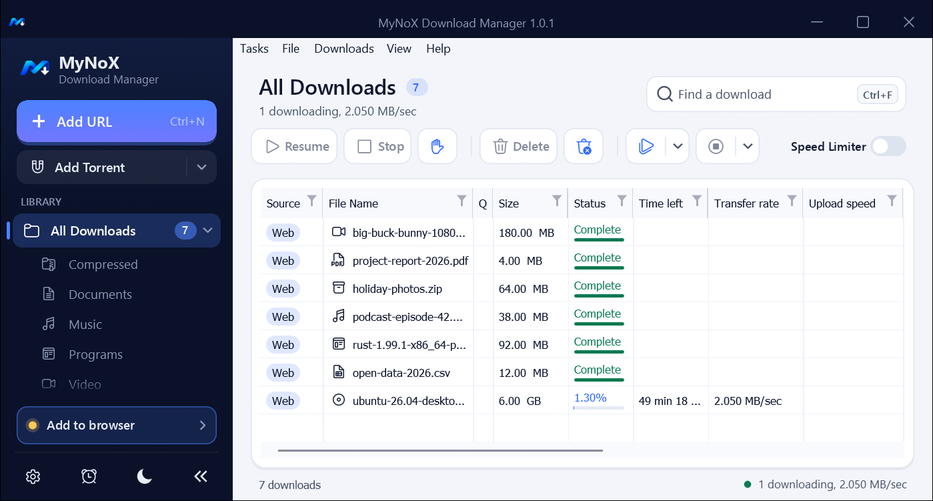
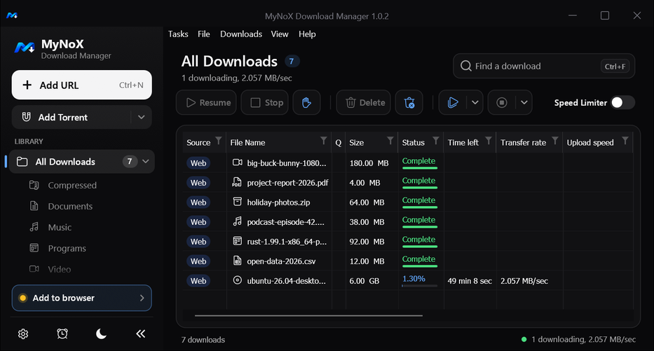
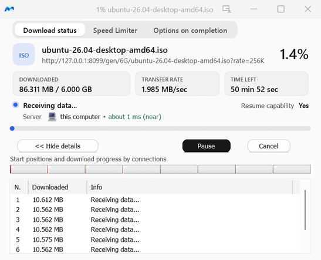
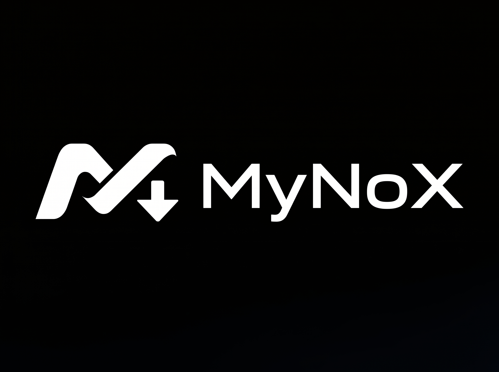

# MyNoX Download Manager

<p align="center">
  
</p>

<h3 align="center">A fast, free download manager for Windows.</h3>

<p align="center">
  <a href="https://mynox-download-manager.vercel.app"><b>Website</b></a> ·
  <a href="https://github.com/InoshMatheesha/MyNoX-Download-Manager/releases/latest"><b>Download</b></a> ·
  <a href="docs/README.md"><b>User guide</b></a> ·
  <a href="CHANGELOG.md"><b>Changelog</b></a>
</p>

<p align="center">
  <a href="https://mynox-download-manager.vercel.app"></a>
  <a href="https://github.com/InoshMatheesha/MyNoX-Download-Manager/releases/latest"></a>
  <a href="https://github.com/InoshMatheesha/MyNoX-Download-Manager/releases"></a>
  
  <a href="LICENSE"></a>
</p>

MyNoX splits every download over several connections, resumes it after the internet or the power
cuts out, catches the links you click in your browser, saves videos, handles torrents, and runs
your queues on a schedule. No ads, no trial, no sign-up.

## MyNoX Choice: the default design

New installs open in **MyNoX Choice**, MyNoX's own design in graphite and white, light and dark:
a sidebar with your downloads library and a big **Add URL** button, a header with search, an
action bar with a **Speed Limiter** switch, the list on a card with a progress bar under every
download, a live download speed card, and a redesigned download window. Every menu and shortcut
is still where it was; **View → Theme** has Classic and ten more themes.

<p align="center">
  
</p>
<p align="center">
  
</p>
<p align="center">
  
</p>

## Download

Get the newest version from **[Releases](https://github.com/InoshMatheesha/MyNoX-Download-Manager/releases/latest)**
or the website, **[mynox-download-manager.vercel.app](https://mynox-download-manager.vercel.app)**:

| File | For |
|---|---|
| `MyNoX-<version>-setup.exe` | **Most people.** The 64-bit setup: installs MyNoX, sets up browser integration and keeps your settings across updates. |
| `MyNoX-<version>-portable.exe` | The portable copy: unpacks MyNoX into any folder or USB stick, keeps its data beside it and writes nothing to the registry. |
| `SHA256SUMS.txt` (+ `.sig`) | The checksums of both files, signed: the built-in updater checks them before it installs. |

Windows may show **"Windows protected your PC"** for a new download: click **More info → Run anyway**.

## Add the browser extension

The setup already registered MyNoX with your browsers; the extension is the last step, and it
comes inside MyNoX.

**One click:** open **Tasks → Browser extension...** (in MyNoX Choice, **Add to browser** in the
sidebar) and click **Add it now** beside your browser. MyNoX opens the browser's extensions page,
copies the extension's folder and shows the three clicks left: **Developer mode** on, **Load
unpacked**, **Ctrl+V** and **Select Folder**. It says **Connected** when it's done.

By hand:

**Chrome, Edge, Brave, Opera, Vivaldi**

1. Open `chrome://extensions` (or `edge://extensions`, `brave://extensions`...).
2. Turn on **Developer mode**.
3. Click **Load unpacked** and choose
   `%LOCALAPPDATA%\Programs\MyNoX Download Manager\extension\chromium`
   (a portable copy has it beside its `mynox.exe`).
4. Click any download link: MyNoX opens **Download File Info**.

**Firefox**

1. Open `about:debugging#/runtime/this-firefox`.
2. Click **Load Temporary Add-on...** and choose `mynox-firefox.xpi` from MyNoX's `extension`
   folder.

Firefox drops a temporary add-on when it closes; Developer Edition, Nightly and ESR can keep it
for good. Every step, with pictures: **[Catch downloads from your browser](docs/guide-catch-browser-downloads.md)**.

## Features

- **Faster downloads** - up to 32 connections per file, rebalanced as parts finish, with a
  per-download and global speed limiter.
- **Resume anything** - broken downloads pick up where they stopped, even after a restart.
- **Browser integration** - Chrome, Edge, Brave, Opera, Vivaldi and Firefox hand their downloads
  to MyNoX; right-click any link for **Download with MyNoX Download Manager**.
- **Video downloader** - a **Download video** button on YouTube and many other sites, whole
  playlists, subtitles, and the quality you pick.
- **Torrents and magnet links** - with per-torrent limits, file selection and a blocklist.
- **Link grabber** - every link of a page or a site, filtered by type, archives unpacked for you.
- **Queues and scheduler** - download overnight, then shut down, sleep or hang up.
- **Categories** - files sorted into Compressed, Documents, Music, Programs and Video folders.
- **Portable mode**, **remote control** from your phone, a **command line** and an **automation API**.
- **86 languages**, right-to-left included, and themes in light and dark, among them
  **MyNoX Choice** with its own sidebar layout.
- **Updates itself** - **Help → Check for updates** installs a new release after checking its signature.

## Screenshots

| | |
| --- | --- |
|  |  |
| | |

| | |
| --- | --- |
| | |
| | |
| | |
| | |
| | |
| | |

## User guide

The full guide is in **[docs/](docs/README.md)**: getting started, browser integration, videos,
torrents, the link grabber, queues and the scheduler, options, the command line and
troubleshooting. **Help** in the app opens the same pages.

## Build from source

You need Windows 10 or 11, [Rust](https://rustup.rs) stable 1.95 or later and, for the setup,
[Inno Setup 6](https://jrsoftware.org/isinfo.php).

```
cargo build --release -p mynox-app
cargo test --workspace
powershell -File tools\installer\build.ps1     # setup + zips into target\dist
```

With the GNU toolchain, put MSYS2's MinGW-w64 (`C:\msys64\mingw64\bin`) on PATH first.
[CONTRIBUTING.md](CONTRIBUTING.md) has the checks to run before a pull request.

## Thanks

MyNoX Download Manager is built on **[Mister Download Manager](https://github.com/anefzaoui/misterdownloadmanager)**
by Ahmed Nefzaoui and its contributors, free software under the GPL. Thank you for the work that
made MyNoX possible.

## Licence

MyNoX Download Manager is free software: you can redistribute it and modify it under the terms of
the [GNU General Public License, version 3 or later](LICENSE). Third-party parts and their
licences are listed in [ATTRIBUTION.md](ATTRIBUTION.md).

<p align="center">Made by <b>MoOdY69</b></p>
