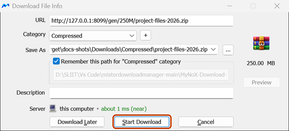
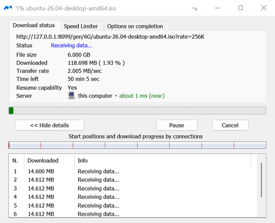
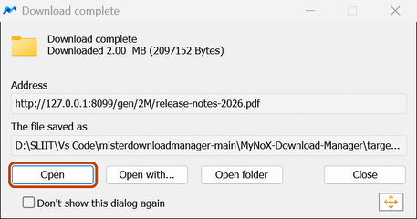
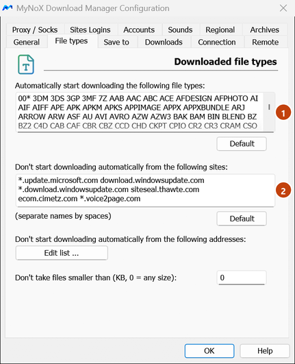

# Tutorial: catch downloads from your browser

[← Back to docs index](README.md)

Set up the extension once, and every download link you click in Firefox, Chrome, Edge, Brave, Opera or Vivaldi goes to MyNoX.

## Before you start

MyNoX must be installed with the setup, with **Set up browser integration (Chrome, Edge, Brave, Firefox)** ticked. It is ticked by default. If you're not sure, run the setup again. A portable copy can't do this.

The extension comes with MyNoX: the setup puts it in the `extension` folder inside MyNoX's folder, and every [release on GitHub](https://github.com/InoshMatheesha/MyNoX-Download-Manager/releases/latest) has it as `MyNoX-<version>-extension-chromium.zip` (Chrome, Edge, Brave, Opera, Vivaldi) and `MyNoX-<version>-extension-firefox.xpi` (Firefox). MyNoX's **Add MyNoX Download Manager to your browser** window, which opens at each start until a browser's extension has reached MyNoX, opens these steps with **Show me how**.

Once it is set up, a download link goes like this:

<!-- steps -->

1. 
   *Click a download link in the browser: Download File Info opens in MyNoX.*
2. 
   *Start Download: the progress window shows it coming in.*
3. 
   *Download complete: Open the file, or Open folder.*

## In Chrome, Edge, Brave, Opera or Vivaldi

1. Open your browser's extensions page: type `chrome://extensions`, `edge://extensions`, `brave://extensions`, `opera://extensions` or `vivaldi://extensions` in the address bar.
2. Turn on **Developer mode** (a switch at the top right; in Edge, at the bottom left).
3. Click **Load unpacked**.
4. Choose the `extension\chromium` folder inside MyNoX's folder: `%LOCALAPPDATA%\Programs\MyNoX Download Manager\extension\chromium` if you installed MyNoX for yourself, `C:\Program Files\MyNoX Download Manager\extension\chromium` for everyone. You can paste the path into the folder box. Or download `MyNoX-<version>-extension-chromium.zip` from the [latest release](https://github.com/InoshMatheesha/MyNoX-Download-Manager/releases/latest), unzip it, and choose that folder.
5. **MyNoX Download Manager** appears. Make sure it is turned on, and pin it to the toolbar if you like.
6. Go to a web page and click a download link, for example a ZIP or an EXE: MyNoX opens **Download File Info**. Click **Start Download**.

Keep the folder where it is: the browser loads the extension from it at every start. After you update MyNoX, click the extension's reload arrow on the extensions page (or restart the browser).

## In Firefox

Firefox installs add-ons for good only when Mozilla has signed them. Until MyNoX's is on addons.mozilla.org:

1. Type `about:debugging#/runtime/this-firefox` in the address bar.
2. Click **Load Temporary Add-on...**.
3. Choose `mynox-firefox.xpi` from the `extension` folder inside MyNoX's folder, or `MyNoX-<version>-extension-firefox.xpi` from the [latest release](https://github.com/InoshMatheesha/MyNoX-Download-Manager/releases/latest).
4. Go to a web page and click a download link: MyNoX opens **Download File Info**. Click **Start Download**.

Firefox removes a temporary add-on when it closes, so repeat these steps after a restart. Firefox Developer Edition, Nightly and ESR can keep it: set `xpinstall.signatures.required` to `false` in `about:config`, then open the `.xpi` file with Firefox (**File → Open File**).

You don't need to start MyNoX first: if it isn't running, it starts by itself.

## Choose what MyNoX takes

- **Which file types:** **Options → File types → Automatically start downloading the following file types**. Add or remove types, separated by spaces.
- **Sites to leave alone:** **Options → File types → Don't start downloading automatically from the following sites**. Add the site's name, for example `downloads.example.com` or `*.example.com`.
- **One browser only:** **Options → General → Capture downloads from the following browsers**. Untick the ones MyNoX should leave alone.

*1 the file types MyNoX takes, 2 the sites it leaves to the browser.*

Everything MyNoX doesn't take stays with the browser.

## Download a link the browser would open

Links to a PDF or a video file, which the browser would open itself, go to MyNoX too when their type is listed. To leave one to the browser, hold **Alt** while clicking it (Firefox opens it; Chrome and Edge download it themselves). Any other link: right-click it and choose **Download with MyNoX Download Manager**, which takes any type.

## Next steps

- [Browser integration in detail (Firefox, private windows, what is sent) →](browser-integration.md)
- [If the browser doesn't hand downloads over →](troubleshooting.md#the-browser-doesnt-send-downloads-to-mynox)
- [Download overnight →](guide-download-overnight.md)
